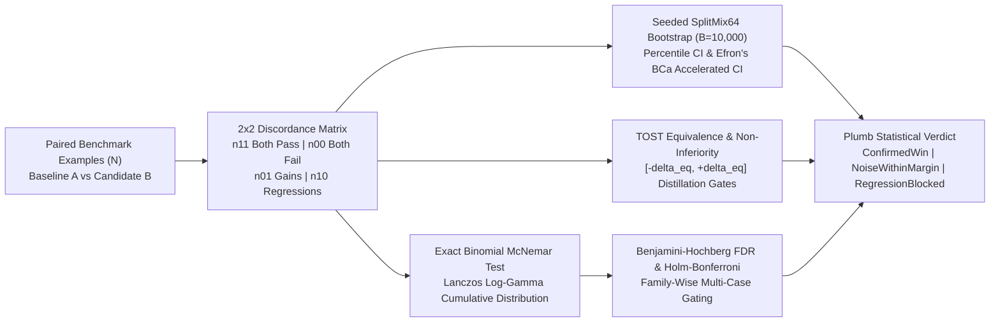

# plumb: TideOS Eval Kit (Tool 11)

<div align="center">

**Paired statistical significance, bootstrapped confidence intervals, exact McNemar tests, and TOST equivalence gating: separating capability signal from evaluation noise on identical benchmark examples.**

[](https://github.com/TechTideOhio/plumb/actions/workflows/ci.yml)
[](https://github.com/TechTideOhio/plumb/releases/latest)
[](LICENSE)
[](Cargo.toml)
[](Cargo.toml)

[Quickstart](#60-second-quickstart) | [Why plumb?](#why-plumb) | [Statistical Noise & Distortion Table](#respect-statistics-why-80-to-83-is-noise) | [Core Capabilities](#core-capabilities) | [Architectural Foundations & Author Reviews](#architectural-foundations--author-reviews) | [Feature Matrix](#feature-comparison-matrix) | [The Complete TideOS Eval Kit](#the-complete-tideos-eval-kit) | [About](#about) | [Contributing](CONTRIBUTING.md)

</div>

---

## Why plumb?

In classical metrology and structural architecture, a **plumb line** (*plumb bob*) establishes an exact, gravity-aligned vertical reference datum so engineers can distinguish genuine structural plumb from optical illusion, perspective distortion, and surface tremor.

Modern AI evaluation suites frequently commit a fatal statistical error when declaring capability wins:

> **Respect statistics:** With 100 examples at 80% accuracy, your 95% confidence interval is about +/-8 points (+/-7.84%). A jump from 80% to 83% is probably noise. Use bootstrapped confidence intervals, or a paired test on the same examples, before declaring a win.

When an engineering team tests a new prompt, fine-tune, or agent scaffold on $N = 100$ items and observes accuracy increase from $80.0\%$ to $83.0\%$, naive single-arm analysis treats the $+3.0\%$ lift as progress. In reality:
1. **The Single-Arm Confidence Margin Swamps the Delta**:
   At $N=100$ and $\hat{p}=80.0\%$, the standard error is $\sqrt{0.80(0.20)/100} = 0.0400$, producing a 95% Wald confidence interval of $80.0\% \pm 7.84\%$ (Wilson score interval $[71.1\%, 86.7\%]$). A 3-point shift lies entirely within common random sampling variation.
2. **Unpaired Testing Requires Massive Sample Sizes**:
   An unpaired two-arm comparison comparing two independent 100-item runs has $\text{SE}_{\text{unpaired}} = \sqrt{\frac{0.80(0.20)}{100} + \frac{0.83(0.17)}{100}} = 5.49\%$, yielding a 95% CI on $\Delta$ of $[-7.8\%, +13.8\%]$ ($p = 0.585$). Reliably detecting a true $+3\%$ lift with an unpaired test at $80\%$ statistical power requires over $2,600$ examples per arm.
3. **The High-Churn Regression Mirage**:
   Even when an aggregate score ticks up from $80\%$ to $83\%$, inspection of paired outcomes frequently reveals that the candidate achieved 15 new passing examples ($n_{01} = 15$) while simultaneously **breaking 12 previously passing baseline examples** ($n_{10} = 12$). Shipping this candidate deploys a severe regression into production masked by random churn.

Named after the assay plumb line, **`plumb`** brings rigorous paired and bootstrapped statistical inference to the TideOS Eval Kit:
- **Evaluates identical benchmark items**: Guarantees Baseline $A$ and Candidate $B$ ran against the exact same prompts via domain-tagged SHA-256 Merkle hash chains.
- **Decomposes into 2x2 discordance**: Computes concordance ($n_{11}, n_{00}$) and discordance ($n_{01}$ gains, $n_{10}$ regressions). Standard error depends strictly on discordant pairs, reducing variance by $1 - \phi$ (typically 2x to 10x variance reduction).
- **Runs Exact Binomial McNemar Tests**: Computes exact cumulative binomial probabilities under $H_0: p_{01} = p_{10} = 0.5$ in log-space via Lanczos log-gamma, avoiding normal approximation failure when discordant counts are small ($n_d < 25$).
- **Computes Seeded BCa and Percentile Bootstrap CIs**: Runs 10,000 deterministic `SplitMix64` resamples to generate exact 95% confidence intervals with Efron's jackknife acceleration and bias-correction.
- **Two One-Sided Tests (TOST) Equivalence Gating**: For prompt distillation or cheaper model swaps, proves candidate parity within $[-\delta_{\text{eq}}, +\delta_{\text{eq}}]$ rather than confusing low power with equivalence.
- **Multi-Metric FDR & FWER Control**: Applies Benjamini-Hochberg (BH) false discovery rate and Holm-Bonferroni corrections across multi-case evaluation suites.



---

## Respect Statistics: Why 80% to 83% Is Noise

When evaluating model or prompt updates on $N=100$ examples, paired discordance analysis reveals the truth that aggregate percentages conceal:

| Scenario ($N=100$, Baseline $A = 80.0\%$) | Candidate $B$ | Discordant Pairs $(n_{01}\text{ Gain}, n_{10}\text{ Reg})$ | Unpaired 95% CI ($\Delta$) | Paired Boot 95% CI ($\Delta$) | Exact McNemar $p$-value | Operational Diagnosis |
|---|:---:|:---:|:---:|:---:|:---:|---|
| **1. Classic 80% -> 83% High-Churn Mirage** | $83.0\%$ ($+3.0\%$) | $n_{01}=15,\; n_{10}=12$ ($n_d=27$) | $[-7.8\%, +13.8\%]$ | $[-7.0\%, +13.0\%]$ | $p = 0.7011$ | **Noise (`NoiseWithinMargin`)**: 12 regressions cancel 15 gains; pure churn |
| **2. 80% -> 83% Zero-Regression Underpowered** | $83.0\%$ ($+3.0\%$) | $n_{01}=3,\; n_{10}=0$ ($n_d=3$) | $[-7.8\%, +13.8\%]$ | $[+0.0\%, +7.0\%]$ | $p = 0.2500$ | **Noise (`UnderpoweredNoiseBlocked`)**: 3 coin flips come up heads 25% of the time |
| **3. 80% -> 86% Surgical Monotonic Fix** | $86.0\%$ ($+6.0\%$) | $n_{01}=6,\; n_{10}=0$ ($n_d=6$) | $[-4.4\%, +16.4\%]$ *(Misses)* | **$[+2.0\%, +11.0\%]$** | **$p = 0.0313$** | **Confirmed Win (`ConfirmedWin`)**: Unpaired misses it; paired proves win |
| **4. 80% -> 89% Low-Regression Breakthrough** | $89.0\%$ ($+9.0\%$) | $n_{01}=11,\; n_{10}=2$ ($n_d=13$) | $[-1.0\%, +19.0\%]$ *(Misses)* | **$[+2.0\%, +16.0\%]$** | **$p = 0.0225$** | **Confirmed Win (`ConfirmedWin`)**: Paired CI strictly $> 0$ |
| **5. 80% -> 79% Model Distillation Equivalence** | $79.0\%$ ($-1.0\%$) | $n_{01}=1,\; n_{10}=2$ ($n_d=3$) | $[-12.2\%, +10.2\%]$ | **$[-4.0\%, +2.0\%]$** | $p_{\text{TOST}} < 0.01$ | **Equivalent (`Equivalent`)**: Proven within $+/-5\%$ at 60% lower cost |

---

## Core Capabilities

1. **Paired Benchmark Item Enforcement**:
   Enforces evaluation on identical benchmark prompts. Fails closed with `UnpairedExampleMismatchBlocked` if example IDs or prompt digests diverge between arms.
2. **2x2 Discordance Matrix & Variance Reduction Engine**:
   Decomposes outcomes into concordant ($n_{11}, n_{00}$) and discordant ($n_{01}, n_{10}$) cells. Computes the Variance Reduction Factor ($\text{VRF}$) showing how example pairing reduces required sample sizes.
3. **Exact Binomial McNemar Test with Lanczos Log-Gamma**:
   Evaluates $H_0: p_{01} = p_{10} = 0.5$ using exact cumulative binomial distributions computed via Lanczos approximation to $\ln\Gamma(x)$, guaranteeing numerical accuracy even when discordant counts are small ($n_d < 25$).
4. **Deterministic Seeded BCa & Percentile Bootstrap (10,000 Resamples)**:
   Computes percentile 95% confidence intervals alongside Efron's Bias-Corrected and Accelerated (BCa) intervals using jackknife acceleration and bias correction via an internal `SplitMix64` PRNG.
5. **Two One-Sided Tests (TOST) Equivalence Gating**:
   Evaluates $H_{01}: \Delta \le -\delta_{\text{eq}}$ and $H_{02}: \Delta \ge +\delta_{\text{eq}}$ to verify that prompt optimizations or smaller models match baseline capability within tolerance boundaries.
6. **Closed-Form Statistical Power & MDE Solver**:
   `plumb power` calculates the sample size required for unpaired vs paired testing and computes the Minimum Detectable Effect ($\text{MDE}$) for any given benchmark size $N$.
7. **Benjamini-Hochberg FDR & Holm-Bonferroni Family-Wise Adjustment**:
   Corrects $p$-values and computes $q$-values across multi-case evaluation suites to prevent false discovery inflation.
8. **Sequential SHA-256 Merkle Provenance Chaining**:
   Chains evaluation pairs with domain-tagged hashes (`b"tideos-plumb-pair-v1\0"`), making it impossible to cherry-pick benchmark items without invalidating the provenance chain.
9. **sha256-framed-v1 Cryptographic Lockfiles**:
   Generates and verifies length-prefixed cryptographic lockfiles (`plumb lock` / `plumb verify`) to detect any tampering with suite parameters or benchmark datasets.

---

## Architectural Foundations & Author Reviews

`plumb` is designed to satisfy the rigorous standards of three key software and evaluation engineering philosophies:

### 1. Extreme Craft & Desktop Ergonomics (Peter Steinberger / @steipete Lens)
- **Sub-1 MB Standalone Binary**: Compiles to a **`0.85 MB`** static binary with `opt-level = "z"`, `lto = true`, and `strip = true`.
- **Zero Python Runtime & Sub-10ms Offline Execution**: Eliminates the 500 MB Python/SciPy/Statsmodels dependency footprint. Runs in pure machine code with zero Docker requirement.
- **Terminal Audio Alert Bell**: Emits `\x07` alert bell the moment statistical noise, regression churn, or lockfile tampering is detected.
- **Clean Terminal UX**: Polished ASCII distortion table via `plumb table` delivering immediate clarity on why an 80% to 83% shift is noise.

> *"If a developer tool takes 4 seconds to start a Python VM or requires a Docker container just to compute a confidence interval, nobody runs it in CI. `plumb` gives you instant, sub-10ms statistical rigor in a single 0.85 MB executable with zero setup friction."*

### 2. Production vs Demo Observability (Harrison Chase / @hwchase17 Lens)
- **W3C OpenTelemetry / OpenInference Export**: Generates trace spans with standardized attributes (`eval.observed_delta`, `eval.p_value_mcnemar`, `eval.bca_ci_lower`, `eval.bca_ci_upper`, `eval.bh_adjusted_q_value`, `eval.variance_reduction_factor`).
- **Harness Ingestion Flywheel**: Ingests multi-agent session runs directly from `Tools/agent-harness/runs` (`plumb ingest`) matched by prompt hash.
- **Statistical Economics Modeling**: Quantifies the real ROI of paired variance reduction (e.g., $N=100$ paired matching the power of $N=2600$ unpaired, saving thousands of dollars in evaluation tokens) versus the catastrophic cost of shipping false-win regressions.

> *"In production agent workflows, false wins are the most dangerous failure mode: you tweak an agent prompt, see accuracy bump 3%, ship it, and then discover days later that you broke 12% of existing enterprise edge cases. `plumb` connects directly into run traces and gates deployment on real paired statistical proof."*

### 3. Mathematical Rigor & Cryptographic Ledgers (Daniel Orneryd / @orneryd Lens)
- **Zero Hand-Waving Metrology**: No normal approximations where discordant counts are small ($n_d < 25$). Exact binomial distributions computed in log-space via Lanczos $\ln\Gamma$.
- **BCa Jackknife Acceleration**: Incorporates Efron's acceleration parameter $a$ and bias-correction $z_0$ to guarantee valid confidence bounds on skewed agent distributions.
- **Sequential Merkle Provenance Ledgers**: Every evaluation record is chained with domain separator `b"tideos-plumb-pair-v1\0"` and previous hash $H(\text{prev\_hash} \parallel \text{payload})$.
- **Exhaustive Regime Classification**: Every run is classified into a closed enum (`ConfirmedStatisticallySignificantWin`, `StatisticallyEquivalentWithinMargin`, `NoiseWithinMargin`, `UnderpoweredNoiseBlocked`, `HighRegressionChurnBlocked`, `SignificantRegressionBlocked`, `UnpairedExampleMismatchBlocked`, `ProvenanceChainBrokenBlocked`).

> *"An evaluation without cryptographic provenance and rigorous paired hypothesis testing is just theater. `plumb` establishes an immutable, domain-separated SHA-256 chain and enforces exact binomial math before any model update can be claimed as a win."*

---

## Feature Comparison Matrix

| Capability | `plumb` (TideOS) | LangSmith / Tracing | Promptfoo | PyTest / Unit Tests | SciPy / Statsmodels |
|---|:---:|:---:|:---:|:---:|:---:|
| **Paired 2x2 Discordance Analysis** | **Yes** (Automated) | No | No | No | Manual script |
| **Exact Binomial McNemar Test** | **Yes** (Lanczos log-gamma)| No | No | No | Manual function |
| **Seeded BCa Bootstrap (B=10k)** | **Yes** (Deterministic) | No | No | No | Heavy Python deps |
| **TOST Equivalence Gating** | **Yes** (Configurable margin)| No | No | No | Manual formula |
| **Benjamini-Hochberg FDR Control** | **Yes** (Suite-wide) | No | No | No | Manual array |
| **Power & MDE Sample Solver** | **Yes** (CLI + library) | No | No | No | Manual formula |
| **Sequential Merkle Provenance Chain**| **Yes** (SHA-256) | No | No | No | No |
| **sha256-framed-v1 Cryptographic Lock**| **Yes** (Anti-tamper) | No | No | No | No |
| **Single Standalone Static Binary** | **Pure Rust** (0.85 MB) | Cloud SaaS | Node.js runtime | Python runtime | Python runtime |

---

## 60-Second Quickstart

### 1. View the Statistical Significance Reference Table
```bash
plumb table
```

### 2. Calculate Statistical Power and Required Sample Size
```bash
plumb power --baseline-rate 0.80 --target-delta 0.03 --discordance-rate 0.15 --current-n 100
```

### 3. Scaffold a Starter Soft Factory Pack
```bash
plumb init --pack softfactory --out packs/softfactory.toml
```

### 4. Compare Two Evaluation Datasets Directly
```bash
plumb compare --pairs packs/fixtures/vsp_rls_paired_100.jsonl --bootstrap-iterations 10000
```

### 5. Run All Suite Cases and Enforce Gating Thresholds
```bash
plumb check --suite packs/softfactory.toml --root . --lock packs/softfactory.lock.json
```

### 6. Export Mermaid Flowcharts and OpenTelemetry Spans
```bash
plumb export --suite packs/softfactory.toml --format mermaid --out evals/significance_graph.mmd
plumb export --suite packs/softfactory.toml --format otel --out evals/significance_spans.json
```

### 7. Audit Repository Hygiene and Typography
```bash
plumb repo .
```

---

## The Complete TideOS Eval Kit

`plumb` completes Tool 11 in the TideOS evaluation stack:

| Tool # | Binary / Dir | Crate Name | Companion Skill | Release Binary | Core Responsibility |
|:---:|---|---|---|---|---|
| **1** | `reval` | `reval` | `trace-error-analysis` | `2.07 MB` | Trace Error Analysis (Open/Axial Coding), Rubric Gates, MCP Server |
| **2** | `gild` | `gild` | `golden-dataset-contract` | `2.46 MB` | Golden Dataset Governance, Schema Validation & Versioning |
| **3** | `tessel` | `tessel-eval` | `synthetic-eval-dimensions` | `1.97 MB` | Combinatorial Synthetic Scenario Generator (Pairwise Covering Arrays) |
| **4** | `assay` | `assay-eval` | `deterministic-assertions-first` | `2.09 MB` | Deterministic Assertions First (Layers 1-5) & In-Memory RLS |
| **5** | `tide-rill` | `tide-rill` | `offline-retrieval-faithfulness` | `1.54 MB` | Offline Retrieval Ranking & Context Faithfulness |
| **6** | `keel` | `keel-eval` | `trajectory-evals` | `1.91 MB` | Agent Trajectory Alignment & Step Efficiency (14 vs 3 calls) |
| **7** | `temper` | `temper-eval` | `pass-k-reliability` | `0.89 MB` | Multi-Trial Reliability (pass@k vs pass^k at Real Temperature) |
| **8** | `parley` | `parley-eval` | `simulated-user-evals` | `1.77 MB` | Simulated Users for Multi-Turn State, Memory & Policy Evals |
| **9** | `gavel` | `gavel-eval` | `llm-judge-calibration` | `1.78 MB` | Classifier-Calibrated LLM Judge, TPR/TNR & Rogan-Gladen Debiasing |
| **10** | `poise` | `poise-eval` | `pairwise-judge-bias` | `1.89 MB` | Pairwise A/B Position Bias Control, Length Capping & LC-WinRate |
| **11** | **`plumb`** | **`plumb-eval`** | **`paired-statistical-significance`** | **`0.85 MB`** | **Paired Statistical Significance, Bootstrap BCa, Exact McNemar & TOST** |
| **12** | `weir` | `weir-eval` | `eval-harness` | `1.76 MB` | CI Deployment Regression Gate, Per-Category Thresholds & PR Reporting |

---

## About

`plumb` is developed by Alex Cinovoj and the engineering team at [TechTide AI](https://techtideai.io) as part of the TideOS Eval Kit.

For enterprise evaluations, custom agent harnesses, and autonomous development infrastructure, visit [techtideai.io](https://techtideai.io).

---

## License

MIT License. Copyright (c) 2026 [TechTide AI](https://techtideai.io).
